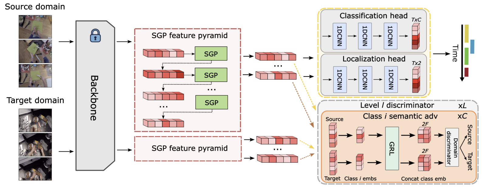

# SADA: Semantic Adversarial Unsupervised Domain Adaptation for Temporal Action Localization

This repository contains the original implementation of the paper [**SADA: Semantic Adversarial Unsupervised Domain Adaptation for Temporal Action Localization**](https://arxiv.org/abs/2312.13377).

## Overview

Temporal Action Localization (TAL) is a critical and challenging task, particularly when applied to unseen domains in real-world settings. These scenarios, which are often neglected in the literature, result in significant performance degradation for traditional models. In this work, we introduce **Semantic Adversarial Unsupervised Domain Adaptation (SADA)**, a novel approach that addresses the problem of domain adaptation in sparse Temporal Action Localization (TAL).

Our contributions are threefold:
1. **Pioneering Domain Adaptation in Sparse TAL**: We introduce the first domain adaptation model that works effectively on realistic sparse action detection benchmarks.
2. **Improved Domain Adaptation**: We overcome the limitations of global-distribution alignment techniques by proposing a novel adversarial loss function sensitive to local class distributions, enabling finer-grained adaptation.
3. **Novel Benchmark Datasets**: We present new benchmarks based on **EpicKitchens100** and **CharadesEgo**, designed to evaluate domain adaptation across multiple shifts comprehensively.

Our experiments show that **SADA** achieves a performance boost of up to **6.14% mAP** compared to state-of-the-art fully supervised models and other UDA methods.



## Installation

### Docker Setup

To set up the environment using Docker, follow these steps:

1. **Build the Docker Image**:
   ```bash
   docker build -t sada_image:latest .
   ```

2. **Run the Docker Container:**
   ```bash
   docker run -it --gpus all --rm --shm-size 15gb -v ./:/SADA -v ./model_results:/SADA/model_results sada_image
   ```

3. **Install Additional Dependencies:**
    ```bash
    pip install setuptools==58.2.0
    pip install -r requirements.txt
    cd ./libs/utils
    python setup.py install
    cd ../..
    pip install plotly joblib gdown
    ```

## Data preparation
### EpicKitchens 100
To download the EpicKitchens dataset, navigate to the data directory and run the following commands:
```bash
gdown "https://drive.google.com/uc?export=download&id=1EnygGoLZMuUV7YNS06bsPInnqyUSDywh" -O ek.zip
unzip ek.zip -d ./
rm ek.zip
```

### CharadesEgo
Similarly, to download the CharadesEgo dataset, run:
```bash
gdown "https://drive.google.com/uc?id=1QATjT4H9XDPGL2dWQkn5nEq2wZYblNqO" -O charades_ego.zip
unzip charades_ego.zip -d ./
rm charades_ego.z
```

## Download the checkpoints
Download the checkpoints and place them under checkpoint directory.
```bash
gdown "https://drive.google.com/uc?id=1Nm6JM3nBr6UgVFhQsw4D-kJgspQTGaSL" -O checkpoints.zip
unzip checkpoints.zip -d ./
rm checkpoints.z
```

## Training from Scratch
To train the model from scratch, run the following command, replacing GPU_NUMBER with the GPU ID and CONFIG_PATH with the path to your desired experiment configuration file:
```python
python train_da.py -i GPU_NUMBER -c ./configs/CONFIG_PATH -n <experiment_name>
```

## Evaluating a model
To evaluate a trained model, run the following command, substituting GPU_NUMBER, CONFIG_PATH, checkpoint_path, and experiment_name with the appropriate values:
```python
python evaluate_da.py -i GPU_NUMBER -c ./configs/CONFIG_PATH -l <checkpoint_path> -n <experiment_name>
```

## Contact
For any questions or inquiries, please contact **david dot pujolperich at gmail dot com**

## Citation
If you find this work useful, please cite our paper:
```
@article{pujol2023sada,
  title={SADA: Semantic adversarial unsupervised domain adaptation for Temporal Action Localization},
  author={Pujol-Perich, David and Clapés, Albert and Escalera, Sergio},
  journal={arXiv preprint arXiv:2312.13377},
  year={2023}
}
```